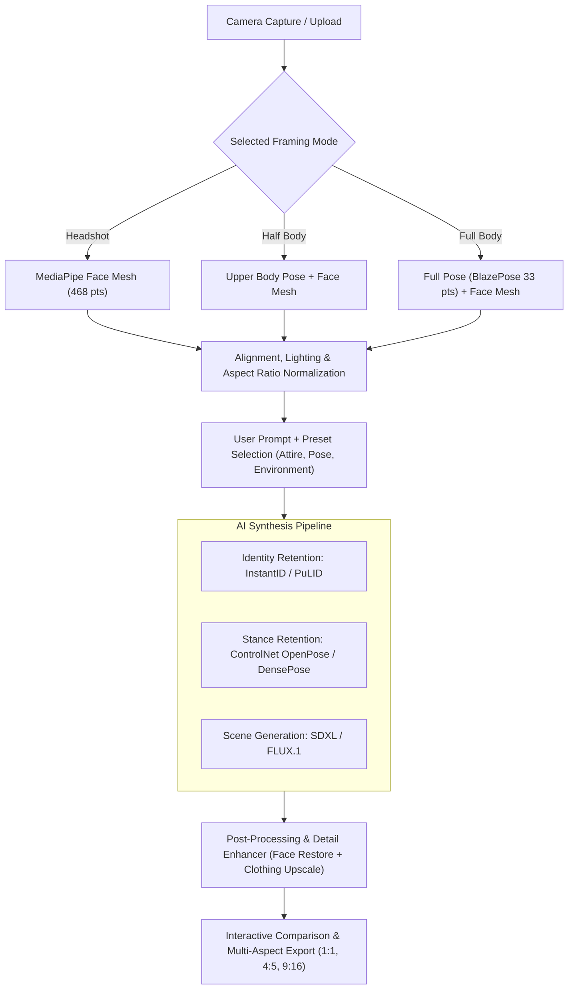

# PersonaCraft AI (Project Blueprint)

> **Identity & Pose-Preserving Prompt-Driven Body & Face Synthesis Application**

---

## 1. Project Identity & Naming

| Attribute | Recommended | Alternatives |
| :--- | :--- | :--- |
| **Project Name** | **PersonaCraft** | BodyMorph AI, Visage & Stance, ChimeraPersona |
| **Repository / Folder** | `personacraft-app` | `bodymorph-app`, `personastudio` |
| **Tagline** | *"Capture your presence. Prompt your reality."* | *"From headshot to full body in any universe."* |

---

## 2. Framing Modes & Coverage Options

The user selects their desired scan scope before or during capture:

| Mode Option | Photographic Term | Coverage Area | Best Used For | Vision / Detection Pipeline |
| :--- | :--- | :--- | :--- | :--- |
| **Headshot** | Close-Up / Portrait | Crown to Clavicle (Face & Shoulders) | Professional headshots, gaming avatars, fantasy faces | MediaPipe Face Mesh (468 landmarks) |
| **Half Body** | Medium Shot | Head to Waist / Hips | Outfit styling, armor, cosplay torso, dynamic hand gestures | MediaPipe Pose (Upper 18 landmarks) + Face Mesh |
| **Full Body** | Full Shot / Head-to-Toe | Head to Feet (Standing / Action) | Full costume, fashion runway, superhero suits, environment immersion | MediaPipe Pose (Full 33 landmarks) + ControlNet OpenPose |
| **Auto-Detect** | Dynamic Framing | Automatically detected based on distance | Quick capture without manual mode toggle | Multi-modal pose + face threshold evaluation |

---

## 3. Core Architecture & Pipeline

---

## 4. Technology Stack & Materials

### Frontend Client
* **Framework**: React 19 + Vite + Tailwind CSS.
* **On-Device Vision Models**:
  * Face Tracking: `@mediapipe/face_mesh`
  * Body & Pose Tracking: `@mediapipe/pose`
* **UI & Interactions**:
  * Framing Guides: Dynamic SVG overlays (Oval for Headshot, Torso silhouette for Half Body, Full Stance bounding box for Full Body).
  * Interactive Slider: Dual-layer Canvas Before/After comparison.

### Backend & AI Inference
* **Identity Preservation**: `InstantID` (SDXL) or `FLUX.1 + PuLID`.
* **Body Stance & Pose Control**: `ControlNet OpenPose` or `DensePose` (extracts skeleton/pose map from the scan so the generated full-body character matches the user's natural posture).
* **Face Restoration**: `CodeFormer` / `GFPGAN` pass for crystal-clear facial micro-details.
* **API Providers**: Fal.ai / Replicate / RunPod Serverless API.

---

## 5. Development Phases (Refactored)

### Phase 1: Foundation & Project Shell
- [ ] Scaffold `personacraft-app` in `C:\Users\ADMIN\React_Projects\Personal-Projects\personacraft-app` (Vite, React 19, Tailwind, Lucide).
- [ ] Implement dark studio shell and global state store (`framingMode`, `capturedFrames`, `promptConfig`, `resultGallery`).

### Phase 2: Multi-Scope Camera & Scanner Engine
- [ ] Build camera module with framing mode selector (`Headshot`, `Half Body`, `Full Body`).
- [ ] Integrate MediaPipe:
  - Headshot guide (oval facial guide).
  - Half-body guide (head-to-waist guide with shoulder alignment).
  - Full-body guide (head-to-toe bounding box with ground plane level indicator).
- [ ] Real-time feedback badges: *"Step Back"*, *"Center Subject"*, *"Lighting Good"*.

### Phase 3: Attire, Scene & Stance Prompt Builder
- [ ] Prompt input with negative prompt drawer.
- [ ] Style & Wardrobe Presets tailored to body framing:
  - *Headshot*: Studio Executive, Cybernetic Implants, Fantasy Crown, Vintage Film.
  - *Half Body*: Tactician Uniform, Medieval Armor, Streetwear Jacket, Victorian Vest.
  - *Full Body*: Space Suit, Superhero Exoskeleton, High Fashion Runway, Martial Arts Stance.
- [ ] Stance control options: *"Keep My Exact Pose"* vs. *"Dynamic Action Pose"*.

### Phase 4: Full Pipeline AI Synthesis Integration
- [ ] Wire up dual-condition pipeline (InstantID for Face + ControlNet OpenPose for Body Stance).
- [ ] Backend API router with streaming task status (`Scanning Landmarks` -> `Rigging Pose` -> `Synthesizing Persona`).
- [ ] Error fallbacks and retry mechanisms.

### Phase 5: Result Viewer, Comparison & Multi-Format Export
- [ ] Interactive Before/After split comparison slider.
- [ ] Multi-aspect ratio export:
  - 1:1 (Square avatar)
  - 4:5 (Instagram portrait)
  - 9:16 (Full-screen mobile wallpaper / TikTok story)
- [ ] HD Download & one-tap variation generator.
